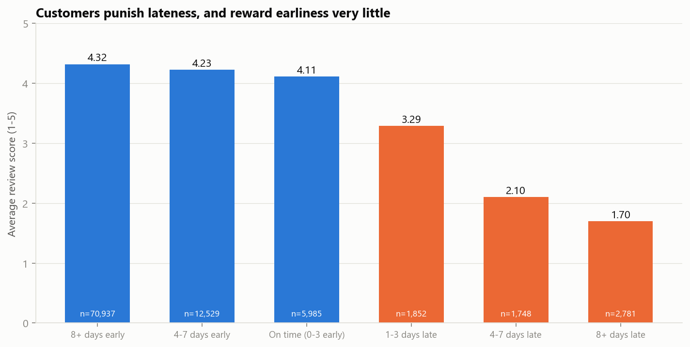
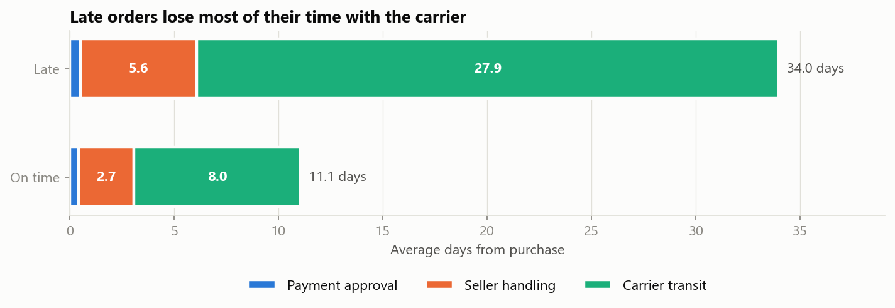
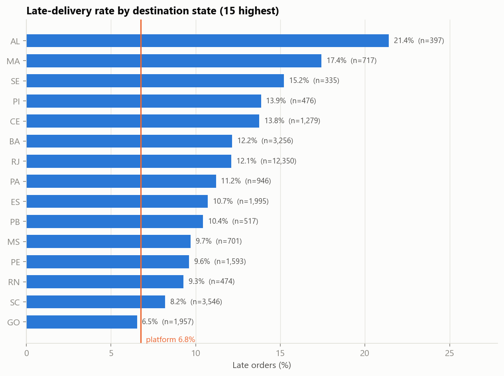
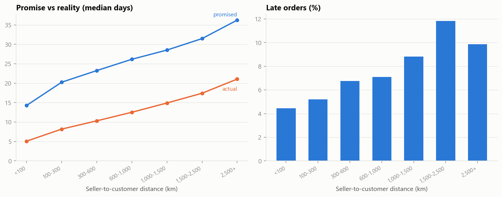
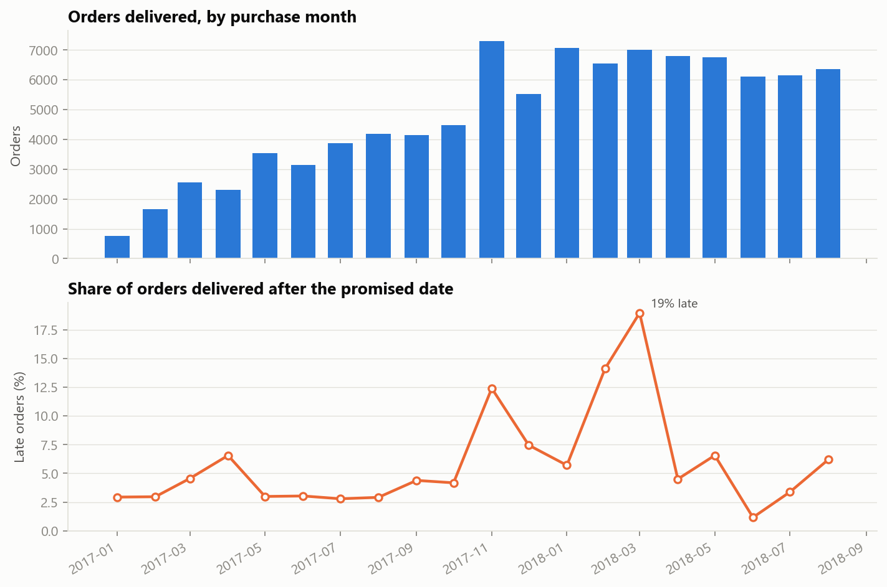
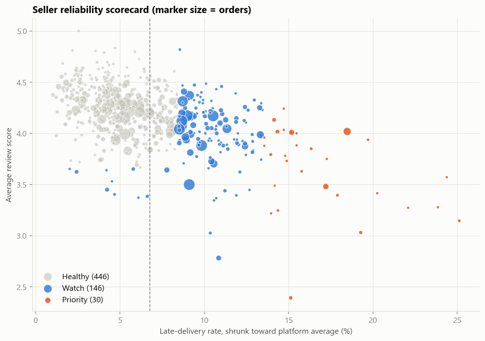
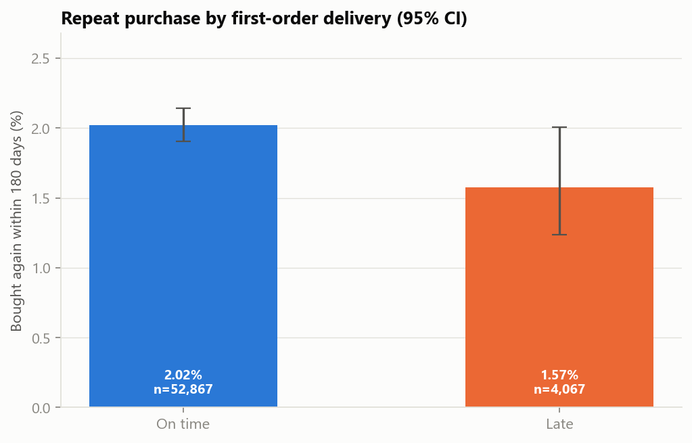
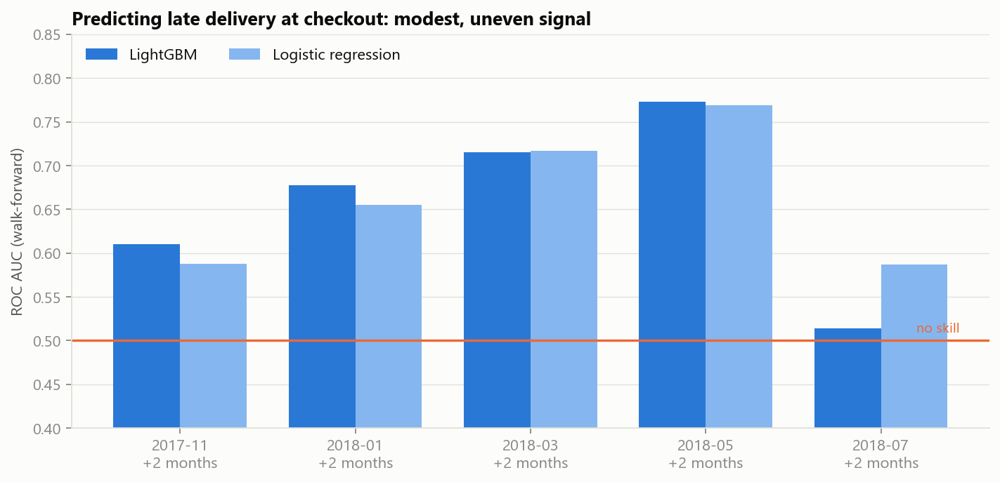
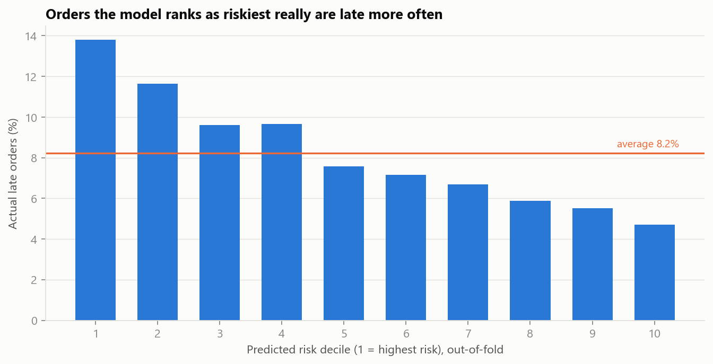

# Findings

_Generated by `scripts/run_pipeline.py`. Re-run the pipeline to refresh every number._

## 1. Late delivery is rare but it is what drives bad reviews

- 96,478 delivered orders; **6.8%** arrived after the promised date (R$ 0.99M of R$ 13.22M item revenue).
- Average review: **4.29** on time vs **2.27** late, a gap of 2.02 stars (95% CI 1.98 to 2.06).
- One-star reviews: 6.6% of on-time orders vs **53.8%** of late orders.
- The penalty grows with the delay: 3.29 stars at 1-3 days late, 1.70 at 8+ days. Arriving 8+ days early earns only +0.20 stars over arriving on time.

## 2. Delays accumulate in carrier transit, not in the warehouse

Late orders take 34.0 days end to end vs 11.0 for on-time ones. Of the extra 22.9 days, **19.9** are carrier transit, 2.9 seller handling and 0.1 payment approval. Seller handling is also slower on late orders, so both matter, but transit dominates.

## 3. Geography: the promise is padded, but not enough far from São Paulo

- Highest late rate by destination: **AL (21.4%)**; lowest among large states: PR (4.0%).
- Orders under 100 km are late 4.4% of the time; at 1,500-2,500 km the rate is 11.8%. The promised window already grows from 14 to 31 days (median delivery goes from 5 to 17), so far lanes get a bigger cushion, yet they are still late more often: long routes are less predictable, not just slower.

## 4. Lateness comes in platform-wide waves

Mid-2017 was calm (2.9% late on average). November 2017, the busiest month on record, ran at 12.4%. The single worst month was **March 2018** at 19.0%. These swings are platform-level, which is why a model trained on one wave transfers poorly to the next (see section 7).

## 5. Sellers: a small group is far less reliable than the rest

Among sellers with at least 30 delivered orders, **30 Priority** sellers (shrunk late rate at least 2x platform) average a 20.4% late rate and 3.65-star reviews, versus 4.2% and 4.26 for 446 Healthy sellers. Priority sellers account for only 3.0% of tier revenue, so intervening costs little. 146 more sit on a Watch list (29.1% of revenue).

## 6. Repeat purchase is rare, and only slightly lower after a late first order

Only about 1.8% of customers buy again within 180 days. By first-order outcome: on-time 2.02% (95% CI 1.90%-2.14%) vs late 1.57% (95% CI 1.23%-2.00%). Late-first customers repeat a little less, but the intervals nearly overlap and the absolute numbers are tiny: on average only 0.5% of a monthly cohort buys again the next month. The measurable cost of lateness here is in reviews, not in repeat revenue.

## 7. Can we predict lateness at checkout? Only modestly

Walk-forward evaluation (train on orders already delivered, score the next two months, five folds):

- LightGBM: mean ROC AUC **0.658**, top-decile lift **2.53x**.
- Logistic regression baseline: ROC AUC 0.663, lift 2.36x. The simple model is as good, so the extra complexity of boosting is not earning its keep.
- Flagging the riskiest 10% of orders catches 17% of late orders (13.8% precision vs 8.2% base rate).
- Feature ablation: adding seller/lane/regime history _lowered_ AUC (order-only 0.658, +history 0.630, +regime 0.594), because those features track one period's delay wave instead of durable seller quality. The shipped model uses order-level features only.
- Performance is uneven: LightGBM AUC ranges from 0.51 to 0.77 across folds (the weakest being the latest period). Treat the model as a triage aid for ranking orders, not a probability forecaster.

## Caveats

- Observational data: reviews and lateness are correlated, not proven causal.
- Orders still in transit when the data ends are excluded, which slightly understates late rates for the newest months.
- Seller and customer locations are zip-prefix centroids, so distances are approximate.
- The dataset covers Sept 2016 to Oct 2018 and is a sample of one marketplace.